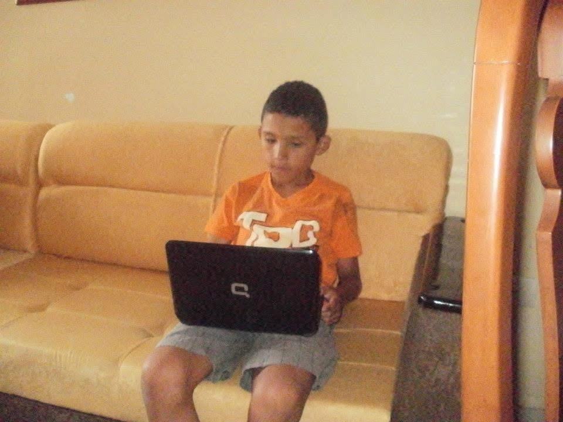
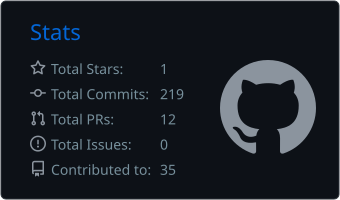

<div align="center">



<br>


<br>



<br>


<br><br>

<a href="https://github.com/REKOL08"></a>
<a href="https://github.com/REKOL08?tab=repositories"></a>
<a href="https://orcid.org/0009-0007-1830-1054"></a>
<a href="https://linkedin.com/in/alejandro-labrada-jimenez-a79768253"></a>


<br><br>

**[Sobre mí](#-sobre-mí) · [Stack](#️-stack) · [Proyectos](#-proyectos-destacados) · [ALLSoft](#-allsoft) · [Experiencia](#-experiencia) · [Formación](#-formación) · [Actividad](#-actividad) · [Contacto](#-contacto)**

</div>

---

## 👤 Sobre mí

<div align="center">

# 🤖 IA &nbsp;×&nbsp; 📚 BIBLIOTECAS &nbsp;×&nbsp; 📊 DATOS &nbsp;×&nbsp; ⚙️ AUTOMATIZACIÓN

</div>

```yaml
name: Alejandro Labrada
role: AI Developer & Technical Library Specialist
organization: Fundación Universitaria del Área Andina — Areandina
team: BIDIG · Library Innovation
education: Systems Engineering — 7th semester
location: Colombia

mission: >
  Turn institutional data, repetitive workflows and information
  resources into useful technology for people.
```

---

## 🛠️ Stack

<div align="center">


<br><br>


</div>

---

## 🧩 Qué construyo

<table>
<tr>
<td width="50%" valign="top">

### 🤖 Inteligencia artificial
Asistentes, flujos inteligentes y herramientas de apoyo a la investigación.

</td>
<td width="50%" valign="top">

### 📚 Tecnología para bibliotecas
Servicios digitales, automatización de repositorios, chatbots y catálogos.

</td>
</tr>
<tr>
<td width="50%" valign="top">

### 📊 Datos y analítica
Motores estadísticos, dashboards y análisis directamente en el navegador.

</td>
<td width="50%" valign="top">

### 🔎 Bibliometría
H-index, producción científica, Lotka, Bradford y visualización.

</td>
</tr>
<tr>
<td width="50%" valign="top">

### ⚙️ Automatización
APIs, n8n y servicios de Google para eliminar tareas repetitivas.

</td>
<td width="50%" valign="top">

### 🌐 Aplicaciones web
Rápidas, accesibles y pensadas para usuarios reales.

</td>
</tr>
</table>

---

## 🚀 Proyectos destacados

<table>
<tr>
<td width="50%" valign="top">

### 📊 AnalisisCuant
**Motor de estadística cuantitativa, 100% en el navegador.**

Descriptivos, pruebas t, ANOVA, correlaciones, alfa de Cronbach y regresión.

`JavaScript` `Chart.js` `Sin backend`

<a href="https://github.com/REKOL08/AnalisisCuant"></a>

</td>
<td width="50%" valign="top">

### 📚 BibliometriX
**Análisis bibliométrico en el navegador.**

Exportaciones de Scopus / Web of Science, índices h y g, leyes de Lotka y Bradford, coautoría.

`Bibliometría` `Visualización` `Scopus`

<a href="https://github.com/REKOL08/BibliometriX"></a>

</td>
</tr>
<tr>
<td width="50%" valign="top">

### 🤖 Librín
**Chatbot de biblioteca con IA y sistema de reservas.**

Disponibilidad, renovaciones, reservas y rutas por sede.

`Node.js` `n8n` `Google Sheets` `IA`

<a href="https://github.com/REKOL08/chatbot"></a>

</td>
<td width="50%" valign="top">

### 📈 Estadincho
**Plataforma de visualización interactiva.**

Sube un Excel o CSV y obtén un dashboard sin escribir código.

`Python` `Dashboard`

<a href="https://github.com/REKOL08/estadincho-gen-v5"></a>

</td>
</tr>
<tr>
<td width="50%" valign="top">

### 🗂️ Digitk
**Automatización de cargue al repositorio institucional.**

Formularios, procesamiento de PDF, organización en Drive y notificaciones.

`Apps Script` `Automatización`

<a href="https://github.com/REKOL08/digitk-cargue-repositorio"></a>

</td>
<td width="50%" valign="top">

### 🖥️ RemoteDesk
**Controla tu PC desde el navegador del celular.**

Mouse, teclado y pantalla en vivo por WebSocket, sin instalar app.

`Python` `WebSocket`

<a href="https://github.com/REKOL08/remotedesk"></a>

</td>
</tr>
<tr>
<td width="50%" valign="top">

### 🎓 Aula universitaria Colombia
**Herramientas abiertas, sin instalación.**

Consultas, ejercicios paso a paso, estadística y conversión de unidades.

`HTML` `JavaScript`

<a href="https://github.com/REKOL08/aula-universitaria-colombia"></a>

</td>
<td width="50%" valign="top">

### 🧪 Laboratorio de matching RRHH
**Compatibilidad candidato–vacante.**

Índice por competencias, experiencia y formación, 100% en el navegador.

`HTML` `JavaScript`

<a href="https://github.com/REKOL08/laboratorio-matching-rrhh"></a>

</td>
</tr>
</table>

---

## 🌐 ALLSoft

<div align="center">

<a href="https://allsoft.pages.dev"></a>

### `FROM DREAM TO CREATION`

**El producto ya está en línea.** Software a la medida y automatización para pequeños negocios en Pereira, Colombia.

<a href="https://allsoft.pages.dev"></a>

<br><br>

<a href="https://allsoft.pages.dev/paquetes"><b>12 automatizaciones n8n gratis</b></a>
&nbsp;·&nbsp;
<a href="https://allsoft.pages.dev/academia/"><b>10 guías paso a paso</b></a>
&nbsp;·&nbsp;
<a href="https://allsoft.pages.dev/desarrollos/"><b>10 sistemas construidos</b></a>

</div>

---

## 💼 Experiencia

### Fundación Universitaria del Área Andina — Areandina
**AI Developer · Technical Library Specialist** &nbsp;`BIDIG · Library Innovation Team`

```text
                    LIBRARY TECHNOLOGY
                           │
          ┌────────────────┼────────────────┐
          ▼                ▼                ▼
         AI              DATA          AUTOMATION
          └────────────────┼────────────────┘
                           ▼
                  RESEARCH TECHNOLOGY
                           ▼
                      REAL USERS
```

- 🤖 Asistentes de IA y chatbots
- 📚 Servicios digitales de biblioteca
- ⚙️ Automatización de flujos de trabajo
- 📊 Análisis y visualización de datos
- 🔎 Herramientas bibliométricas
- 🗂️ Flujos del repositorio institucional

### 🔨 Construyendo ahora

```yaml
now:
  - Integración con la API REST de Koha
  - Acceso al catálogo en tiempo real para Librín
  - Experiencias e-learning en Odilo
  - Capa de visualización de Estadincho
  - Herramientas de IA para servicios de biblioteca
  - 50 Projects Challenge

philosophy: [build, test, automate, document, improve]
```

---

## 🎓 Formación

<details>
<summary><b>📖 Competencias en desarrollo</b></summary>

<br>

| Área | Alcance | Palabras clave |
| --- | --- | --- |
| IA generativa | Fundamentos de LLM, diseño de prompts, modelos de difusión y evaluación de salidas | `Generative AI` · `LLMs` · `Prompt Engineering` |
| IA responsable | Colaboración humano–IA, gobernanza, transparencia y revisión crítica | `Responsible AI` · `AI Fluency` |
| Nube y datos | Transformación digital, modelos de servicio en la nube y gobierno de datos | `Google Cloud` · `Data Fundamentals` |
| Automatización | Funciones personalizadas en hojas de cálculo y normalización de datos | `Apps Script` · `Google Sheets` · `JavaScript` |
| Programación y web | Python, C#, interfaces HTML/CSS/JavaScript | `Python` · `C#` · `HTML` · `CSS` |
| Accesibilidad web | HTML semántico, contraste y navegación por teclado | `a11y` · `Semantic HTML` |

**En curso:** Python, ciberseguridad, seguridad de redes y desarrollo backend.

</details>

<details>
<summary><b>🏅 Credenciales obtenidas (octubre 2026)</b></summary>

<br>

| Proveedor | Curso o módulo | Reconocimiento |
| --- | --- | --- |
| Google Skills | [Introduction to Generative AI](https://www.skills.google/course_templates/536) | Insignia |
| Google Skills | [Introduction to Large Language Models](https://www.skills.google/course_templates/539) | Insignia |
| Google Skills | [Responsible AI: Applying AI Principles with Google Cloud](https://www.skills.google/course_templates/388) | Insignia |
| Google Skills | [Introduction to Image Generation](https://www.skills.google/course_templates/541) | Insignia |
| Google Skills | [Digital Transformation with Google Cloud](https://www.skills.google/course_templates/266) | Insignia |
| Google Skills | [Exploring Data Transformation with Google Cloud](https://www.skills.google/course_templates/267) | Insignia |
| Anthropic · Claude Academy | [AI Fluency: Framework and foundations](https://academy.claude.com/courses/ai-fluency-framework-foundations) | Insignia |
| Microsoft Learn | [Write your first C# code](https://learn.microsoft.com/en-us/training/modules/csharp-write-first/) | Módulo |
| Microsoft Learn | [Introduction to web development using Visual Studio Code](https://learn.microsoft.com/en-us/training/modules/get-started-with-web-development/) | Módulo |
| Microsoft Learn | [Web accessibility fundamentals](https://learn.microsoft.com/en-us/training/modules/web-development-101-accessibility/) | Módulo |
| Microsoft Learn | [Introduction to Git](https://learn.microsoft.com/en-us/training/modules/intro-to-git/) | Módulo |
| Microsoft Learn | [Prepare for an AI development project](https://learn.microsoft.com/en-us/training/modules/prepare-azure-ai-development/) | Módulo; laboratorio Azure pendiente |

</details>

---

## 📈 Actividad

<div align="center">

<picture>
  <source media="(prefers-color-scheme: dark)" srcset="https://raw.githubusercontent.com/REKOL08/REKOL08/output/github-contribution-grid-snake-dark.svg">
  <source media="(prefers-color-scheme: light)" srcset="https://raw.githubusercontent.com/REKOL08/REKOL08/output/github-contribution-grid-snake.svg">
  
</picture>

<br><br>


<br>




<br><br>


</div>

---

## 💡 Filosofía

<div align="center">

```text
 Si la tecnología puede quitar una tarea repetitiva   →  AUTOMATÍZALA.
 Si los datos pueden responder la pregunta            →  VISUALÍZALOS.
 Si la IA puede mejorar el flujo de trabajo           →  INTÉGRALA.
 Si el usuario necesita entender lo complejo          →  SIMPLIFÍCALO.
```

### Construyendo tecnología que hace la información más fácil de usar.

</div>

---

## 📬 Contacto

<div align="center">

<a href="https://orcid.org/0009-0007-1830-1054"></a>
<a href="https://linkedin.com/in/alejandro-labrada-jimenez-a79768253"></a>
<a href="https://github.com/REKOL08"></a>

<br><br>


<br>


</div>
