<div align="center">


<a href="https://github.com/REKOL08"></a>



<a href="https://orcid.org/0009-0007-1830-1054"></a>
<a href="https://linkedin.com/in/alejandro-labrada-jimenez-a79768253"></a>
<a href="https://allsoft.pages.dev"></a>

<br><br>




</div>


<table>
<tr>
<td width="50%" valign="top">

### 📊 AnalisisCuant
**Motor de estadística cuantitativa, 100% en el navegador.**
Descriptivos, pruebas t, ANOVA, correlaciones, alfa de Cronbach y regresión.

`JavaScript` `Chart.js` `Sin backend`

<a href="https://github.com/REKOL08/AnalisisCuant"></a>

</td>
<td width="50%" valign="top">

### 📚 BibliometriX
**Análisis bibliométrico en el navegador.**
Scopus / Web of Science, índices h y g, leyes de Lotka y Bradford, coautoría.

`Bibliometría` `Visualización` `Scopus`

<a href="https://github.com/REKOL08/BibliometriX"></a>

</td>
</tr>
<tr>
<td width="50%" valign="top">

### 🤖 Librín
**Chatbot de biblioteca con IA y reservas.**
Disponibilidad, renovaciones, reservas y rutas por sede.

`Node.js` `n8n` `Google Sheets` `IA`

<a href="https://github.com/REKOL08/chatbot"></a>

</td>
<td width="50%" valign="top">

### 📈 Estadincho
**Visualización interactiva sin código.**
Sube un Excel o CSV y obtén un dashboard.

`Python` `Dashboard`

<a href="https://github.com/REKOL08/estadincho-gen-v5"></a>

</td>
</tr>
<tr>
<td width="50%" valign="top">

### 🗂️ Digitk
**Cargue automatizado al repositorio institucional.**
Formularios, PDF, organización en Drive y notificaciones.

`Apps Script` `Automatización`

<a href="https://github.com/REKOL08/digitk-cargue-repositorio"></a>

</td>
<td width="50%" valign="top">

### 🖥️ RemoteDesk
**Tu PC desde el navegador del celular.**
Mouse, teclado y pantalla en vivo por WebSocket.

`Python` `WebSocket`

<a href="https://github.com/REKOL08/remotedesk"></a>

</td>
</tr>
<tr>
<td width="50%" valign="top">

### 🎓 Aula universitaria Colombia
**Herramientas abiertas, sin instalación.**
Consultas, ejercicios paso a paso y estadística.

`HTML` `JavaScript`

<a href="https://github.com/REKOL08/aula-universitaria-colombia"></a>

</td>
<td width="50%" valign="top">

### 🧪 Matching RRHH
**Compatibilidad candidato–vacante.**
Índice por competencias, experiencia y formación.

`HTML` `JavaScript`

<a href="https://github.com/REKOL08/laboratorio-matching-rrhh"></a>

</td>
</tr>
</table>


<div align="center">

<a href="https://allsoft.pages.dev">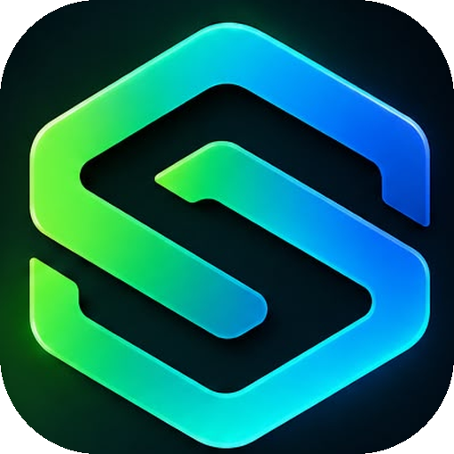</a>

**El producto ya está en línea.** Software a la medida y automatización para pequeños negocios en Pereira, Colombia.

<a href="https://allsoft.pages.dev/paquetes"><b>12 automatizaciones n8n gratis</b></a> &nbsp;·&nbsp;
<a href="https://allsoft.pages.dev/academia/"><b>10 guías paso a paso</b></a> &nbsp;·&nbsp;
<a href="https://allsoft.pages.dev/desarrollos/"><b>10 sistemas construidos</b></a>

</div>


### Fundación Universitaria del Área Andina — Areandina
**AI Developer · Technical Library Specialist** &nbsp;`BIDIG · Library Innovation Team` &nbsp;·&nbsp; Ingeniería de Sistemas, 7.º semestre

- 🤖 Asistentes de IA y chatbots · 📚 Servicios digitales de biblioteca
- ⚙️ Automatización de flujos · 📊 Análisis y visualización de datos
- 🔎 Herramientas bibliométricas · 🗂️ Flujos del repositorio institucional

```yaml
building_now:
  - Integración con la API REST de Koha
  - Acceso al catálogo en tiempo real para Librín
  - Experiencias e-learning en Odilo
  - Capa de visualización de Estadincho
  - 50 Projects Challenge
philosophy: [build, test, automate, document, improve]
```


<details>
<summary><b>📖 Competencias en desarrollo</b></summary>

<br>

| Área | Alcance | Palabras clave |
| --- | --- | --- |
| IA generativa | Fundamentos de LLM, diseño de prompts, modelos de difusión y evaluación de salidas | `Generative AI` · `LLMs` · `Prompt Engineering` |
| IA responsable | Colaboración humano–IA, gobernanza, transparencia y revisión crítica | `Responsible AI` · `AI Fluency` |
| Nube y datos | Transformación digital, modelos de servicio en la nube y gobierno de datos | `Google Cloud` · `Data Fundamentals` |
| Automatización | Funciones personalizadas en hojas de cálculo y normalización de datos | `Apps Script` · `Google Sheets` · `JavaScript` |
| Programación y web | Python, C#, interfaces HTML/CSS/JavaScript | `Python` · `C#` · `HTML` · `CSS` |
| Accesibilidad web | HTML semántico, contraste y navegación por teclado | `a11y` · `Semantic HTML` |

**En curso:** Python, ciberseguridad, seguridad de redes y desarrollo backend.

</details>

<details>
<summary><b>🏅 Credenciales obtenidas (octubre 2026)</b></summary>

<br>

| Proveedor | Curso o módulo | Reconocimiento |
| --- | --- | --- |
| Google Skills | [Introduction to Generative AI](https://www.skills.google/course_templates/536) | Insignia |
| Google Skills | [Introduction to Large Language Models](https://www.skills.google/course_templates/539) | Insignia |
| Google Skills | [Responsible AI: Applying AI Principles with Google Cloud](https://www.skills.google/course_templates/388) | Insignia |
| Google Skills | [Introduction to Image Generation](https://www.skills.google/course_templates/541) | Insignia |
| Google Skills | [Digital Transformation with Google Cloud](https://www.skills.google/course_templates/266) | Insignia |
| Google Skills | [Exploring Data Transformation with Google Cloud](https://www.skills.google/course_templates/267) | Insignia |
| Anthropic · Claude Academy | [AI Fluency: Framework and foundations](https://academy.claude.com/courses/ai-fluency-framework-foundations) | Insignia |
| Microsoft Learn | [Write your first C# code](https://learn.microsoft.com/en-us/training/modules/csharp-write-first/) | Módulo |
| Microsoft Learn | [Introduction to web development using Visual Studio Code](https://learn.microsoft.com/en-us/training/modules/get-started-with-web-development/) | Módulo |
| Microsoft Learn | [Web accessibility fundamentals](https://learn.microsoft.com/en-us/training/modules/web-development-101-accessibility/) | Módulo |
| Microsoft Learn | [Introduction to Git](https://learn.microsoft.com/en-us/training/modules/intro-to-git/) | Módulo |
| Microsoft Learn | [Prepare for an AI development project](https://learn.microsoft.com/en-us/training/modules/prepare-azure-ai-development/) | Módulo; laboratorio Azure pendiente |

</details>


<div align="center">

<picture>
  <source media="(prefers-color-scheme: dark)" srcset="https://raw.githubusercontent.com/REKOL08/REKOL08/output/github-contribution-grid-snake-dark.svg">
  <source media="(prefers-color-scheme: light)" srcset="https://raw.githubusercontent.com/REKOL08/REKOL08/output/github-contribution-grid-snake.svg">
  
</picture>

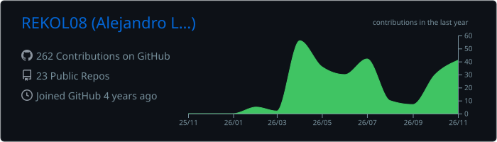


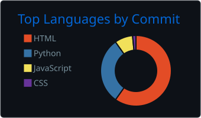
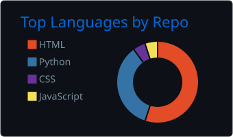
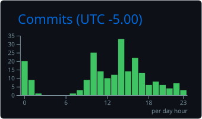


</div>


<div align="center">

<a href="https://orcid.org/0009-0007-1830-1054"></a>
<a href="https://linkedin.com/in/alejandro-labrada-jimenez-a79768253"></a>
<a href="https://github.com/REKOL08"></a>


</div>
